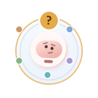
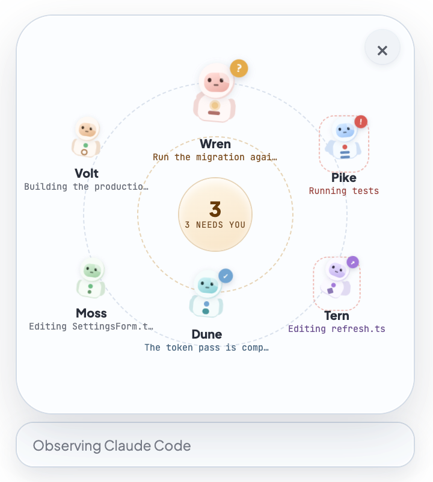

<p align="center">
  
</p>

<h1 align="center">Orbit</h1>

<p align="center">
  <strong>Mission control for your Claude Code sessions. Every session is a little astronaut floating on your desktop, and the ones that need you come to the front.</strong>
</p>

<p align="center">
  
  
  
  
</p>

<p align="center">
  
</p>

Running several Claude Code sessions at once means checking tabs to see who's waiting. Orbit sits in a corner of your screen as a small pod. When a session asks for permission, has a question or looks stuck, the pod says so. Open it and each session is an astronaut on an orbit: hover one to see what it's doing, click it to jump to its terminal tab.

## Features

**See every session**

- **One pod, the strongest signal:** collapsed, Orbit shows the most urgent thing: a permission, a question, a waiting session, or a session that may need a check. Otherwise it shows how many sessions are active or finished.
- **A crew, not a list:** each session gets its own astronaut, color and mark. The ones that need you sit closest to the center, and the center counts them.
- **Hover to peek:** the session's title, its state, and one live activity such as *Editing SettingsForm.tsx* or *Running tests*. Below that, the file, command, search query, or a question's choices.
- **Stable under your pointer:** astronauts don't reshuffle while you hover one or drag Orbit, so status changes never move your target.

**Get to the right place**

- **Click to open:** Orbit finds the Claude process, walks its parents to the app that hosts it, and focuses that exact **Terminal** or **iTerm** tab by its TTY. Other apps (VS Code, Warp, Ghostty…) come to the front.
- **Shortcut:** <kbd>Control</kbd> <kbd>Option</kbd> <kbd>O</kbd> opens or closes the scene from anywhere.

**Notice trouble early**

Beyond what Claude Code reports, Orbit flags three patterns, always as a possibility with its reason attached:

| Badge | Signal | Rule |
|---|---|---|
| <kbd>!</kbd> red | Maybe stuck | The same tool action repeats at least 3 times in the last 6 |
| <kbd>!</kbd> red | Maybe stuck | Claude says it's busy, but nothing has happened for 45 seconds |
| <kbd>↗</kbd> purple | Maybe drifting | The file being touched is outside the session's project folder |

**Stays out of the way**

- **Floats, never steals focus:** a transparent, always-on-top window on every Space, hidden from the Dock. Empty space clicks through to the apps behind it.
- **Drag it anywhere:** springy dragging that snaps to screen edges and remembers where you left it.
- **Read-only:** Orbit never types into a terminal, approves a permission, or starts or resumes Claude.
- **Reduce Motion:** respected live, even when you change it while Orbit runs.

## A closer look

### Pod and scene

<p align="center">
  
  &nbsp;&nbsp;&nbsp;
  
</p>

Collapsed, the pod shows the lead session's face and a badge. Click it (hovering only previews) and the scene opens in place. It stays open until you close it, press the shortcut, or open a session. Astronauts crossfade between pod and orbit instead of flying across the screen, and every animation is a spring you can reverse halfway.

### States

| State | Meaning |
|---|---|
| **Waiting** <kbd>?</kbd> | Needs your permission, an answer, or input |
| **Maybe stuck** <kbd>!</kbd> | Repeating itself or silent while busy |
| **Maybe drifting** <kbd>↗</kbd> | Working outside its project |
| **Done** <kbd>✓</kbd> | Finished its last response |
| **Working** | Busy, nothing to do yet |
| **Idle** | Open, nothing running |

Waiting sessions rank first, permissions before questions. The bar under the scene shows *Observing Claude Code*, or *Hook coverage degraded* when hooks aren't reporting.

## Install

There's no published release yet. Build it yourself:

```sh
git clone https://github.com/syedmazharaliraza/orbit.git && cd orbit
npm install
npm run package:mac      # builds the app and a .dmg for Apple Silicon
```

Open the `.dmg` from `dist/` and move **Orbit.app** to Applications.

**Requires** macOS on Apple Silicon, [Claude Code](https://docs.anthropic.com/en/docs/claude-code), and Xcode Command Line Tools (`swiftc`) to build the hook collector.

### First launch

On first launch Orbit adds its hooks to Claude Code (see below), sets itself to open at login, and appears in the bottom-right corner. **Restart any running Claude Code sessions** so they load the hooks.

The first time you click a session in Terminal or iTerm, macOS asks whether Orbit may control that app. Allow it so Orbit can select the right tab. You can change it later in **System Settings → Privacy & Security → Automation**.

## How it works

Everything stays on your Mac. Orbit makes no network requests.

```
Claude Code ──hook──▶ orbit-claude-hook-collector ──▶ inbox/ ──▶ Orbit (worker thread) ──▶ astronauts
```

- **Hooks:** Orbit registers a small native collector for 25 Claude Code hook events (`SessionStart`, `PreToolUse`, `PermissionRequest`, `Notification`, `Stop`, …) in `~/.claude/settings.json` (or `$CLAUDE_CONFIG_DIR`). Your existing settings and hooks are kept, a backup is written next to the file, and the change is atomic.
- **The collector** is a Swift binary with a 1-second timeout. It writes a minimized record and exits successfully every time, including on failure. It never returns a decision, rewrites input or adds context, so it can't affect Claude.
- **What it records:** session and tool IDs, working folder, model, session title, tool name, file paths, search patterns, a command preview (up to 512 characters), the first 360 characters of a prompt, and question choices. Never transcripts or tool output.
- **Inbox:** records land in `~/Library/Application Support/Orbit/claude-observation/inbox` and are deleted once read. A checkpoint keeps current state plus a journal capped at 24 hours, 10,000 events and 32 MiB.
- **Recovery:** at startup Orbit takes one snapshot from `claude agents --json` and `~/.claude/sessions`, then watches that folder for changes hooks can't report. It doesn't poll.
- **Off the main thread:** observation and checkpointing run in a Node worker thread. Updates to the UI are batched every 80 ms and deduplicated.
- **Preferences:** only Orbit's position and login setting, in `orbit-state.json`. No session data.

### Managing hooks yourself

```sh
npm run build:collector   # compile the Swift collector into .build/
npm run hooks:preview     # show the settings file, paths and events; changes nothing
npm run hooks:install     # install (idempotent, with backup)
npm run hooks:uninstall   # remove only the handlers Orbit added, if unchanged
```

For the packaged app, point setup at its bundled collector:

```sh
node scripts/claude-hooks.mjs --collector "/Applications/Orbit.app/Contents/Resources/orbit-claude-hook-collector" --apply
```

See [CLAUDE-HOOKS.md](CLAUDE-HOOKS.md) for details.

## Troubleshooting

- **The bar says *Hook coverage degraded*:** hooks are missing or not reporting. Run `npm run hooks:preview`, then `npm run hooks:install`, and restart your Claude Code sessions.
- **A session appears but shows little detail:** it started before the hooks were installed. Restart it.
- **Clicking opens the app, not the tab:** allow Orbit under **Privacy & Security → Automation** for Terminal or iTerm. Tab selection only works in those two.
- **"The Claude process is no longer running":** the session has ended since Orbit last saw it.
- **In development, hook install fails:** run `npm run build:collector` first.
- **The shortcut does nothing:** another app already uses <kbd>Control</kbd> <kbd>Option</kbd> <kbd>O</kbd>.

## Development

Requires Node.js, npm and Xcode Command Line Tools.

```sh
npm install
npm run dev                                   # build the collector and start with hot reload
ORBIT_USE_MOCK_WORKERS=true npm run dev       # a fake crew, no Claude needed
ORBIT_USE_MOCK_WORKERS=true ORBIT_MOCK_SCENARIO=permission npm run dev   # one scenario: permission, input, waiting, check
ORBIT_START_MODE=expanded npm run dev         # start with the scene open
npm run build                                 # production build into out/
npm run package:mac                           # .dmg for Apple Silicon
```

Tests and checks:

```sh
npx tsc --noEmit
npm run test:hooks                # hook reducer, installer and session opener
npm run test:interaction:unit     # hover, pin and preview state machine
npm run test:observation-worker   # worker thread and checkpoint compatibility
npm run test:interaction          # drives the real built app in Electron
ORBIT_TRACE=1 npm run test:interaction && node test/summarize-interaction-trace.cjs   # frame timings
npm run profile:observation       # checkpoint serialization cost
```

| Path | What's there |
|---|---|
| `src/main` | Electron main process: window, IPC, hook install on startup, login item |
| `src/main/claude/hooks` | Hook installer, inbox receiver, normalizer, event reducer, session recovery |
| `src/main/claude` | Worker manager, observation worker thread, attention rules, session opener |
| `src/main/window` | The transparent window, click-through and drag positioning |
| `src/renderer` | React UI: pod, orbit scene, astronauts, hover preview, Motion springs |
| `src/shared` | Types and scene geometry shared across processes |
| `native/OrbitHookCollector` | The Swift hook collector |
| `scripts/claude-hooks.mjs` | Preview, install and uninstall hooks from the command line |
| `test` | Unit tests and the Electron interaction harness |

[INTERACTIONS.md](INTERACTIONS.md) explains the interaction and animation design, its performance numbers, and what still needs testing on real hardware.

## Acknowledgements

Orbit inspired [Peeku](https://github.com/ahrefabhi/Peeku), a native notch companion for Claude Code and Codex. Check it out.

Orbit works with [Claude Code](https://docs.anthropic.com/en/docs/claude-code) but isn't affiliated with Anthropic.
